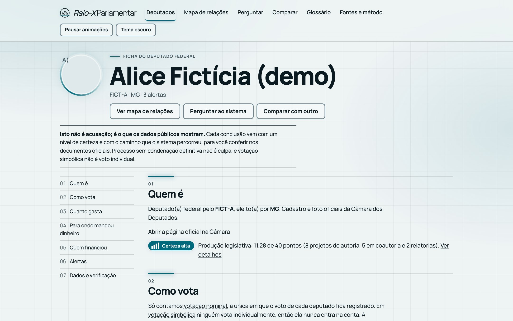
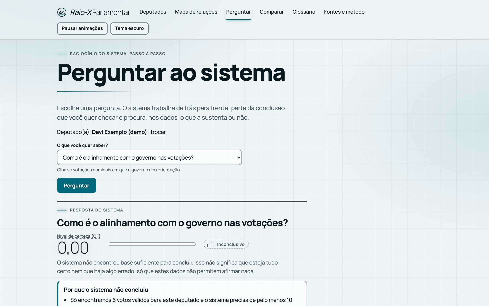
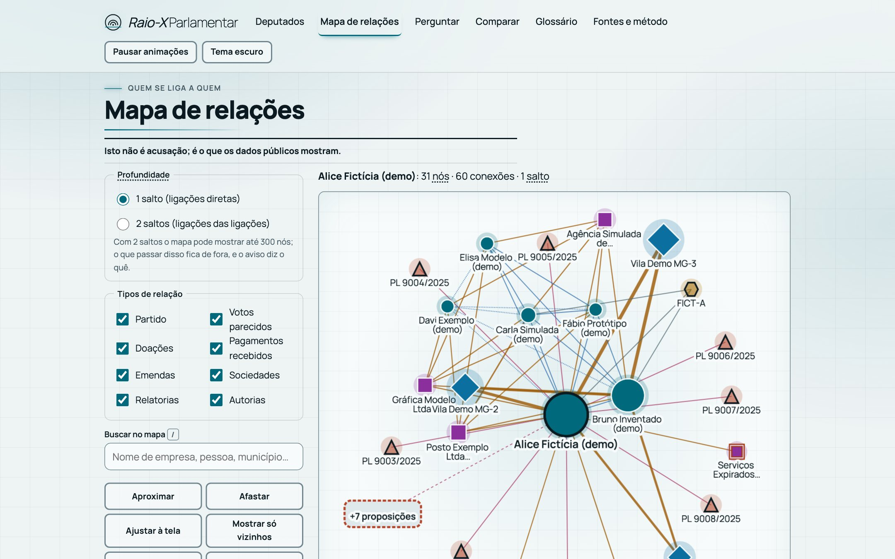
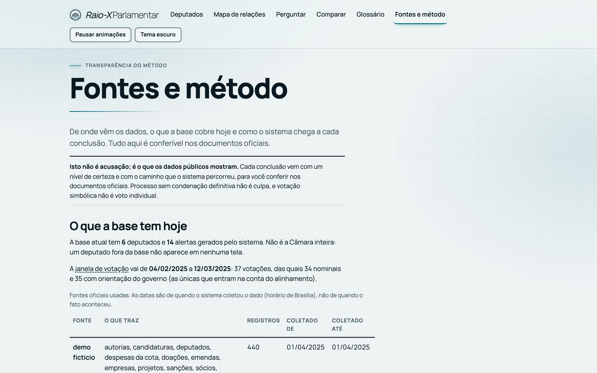
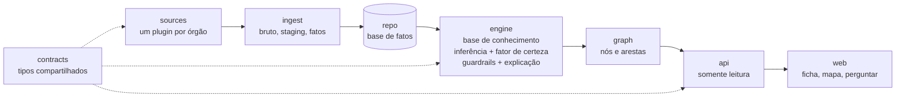

# Raio-X Parlamentar

Tudo o que é público sobre um deputado federal (votos, projetos, gastos, emendas, financiamento,
empresas e sanções) explicado em linguagem simples, com cada conclusão mostrando **como** foi obtida
e **o quanto** é certa. É um **Sistema Especialista**: base de fatos (dados oficiais), base de
conhecimento (regras em YAML em [`knowledge/rules/`](knowledge/rules/_schema.md)), motor de inferência
com fatores de certeza e módulo de explicação. Os fatos viram um grafo navegável de relações.

**Para quem:** cidadãos que querem entender o mandato de quem votaram, jornalistas de dados e analistas
que precisam de pistas rastreáveis até a fonte oficial, e estudantes de Sistemas Especialistas que
querem ver um motor de regras completo e pequeno.

> **Isto não é acusação; é o que os dados públicos mostram.**
> Processo sem condenação definitiva não é culpa, e o sistema se recusa a tratá-lo como tal
> (guardrail **R08**, presunção de inocência). Votação simbólica não é voto individual e fica de fora
> de qualquer conta de votos (guardrail **R02**). Todo resultado traz nível de certeza e link para a
> fonte oficial. Leia a [política de uso e correção](docs/politica-de-uso-e-correcao.md).

## Capturas de tela





## Como funciona
A dependência corre em uma direção só: uma camada nunca importa a que está à sua direita.


O motor faz encadeamento progressivo (dos fatos às conclusões) e regressivo (de um objetivo aos fatos
que o provam). Detalhes em [docs/arquitetura.md](docs/arquitetura.md).

## 5 minutos até rodar
Pré-requisitos: Python (3.11+ suportado, 3.12 recomendado) com [uv](https://docs.astral.sh/uv/), Node 22 com pnpm 12.

```
make setup     # instala as dependências Python
make demo      # gera o banco fictício, offline (passo a passo em docs/demo.md)
make test      # testes
```
Para subir a API e o site (dois terminais):
```
make dev-demo                        # API em http://localhost:8000 (documentação em /docs), sobre o banco da demo
cd web && pnpm install && pnpm dev   # site em http://localhost:3000
```
`make dev-demo` já define o sal e o banco da demonstração. Para rodar a API sobre outro banco (por exemplo o da
amostra real), use `make dev` com `RAIO_X_ID_SALT` e `RAIO_X_DB` definidos: sem o sal a API não sobe.
Com dados reais (precisa de internet): `make sample` ingere 20 deputados de MG e roda o motor.
Todos os comandos estão em [CONTRIBUTING.md](CONTRIBUTING.md).

## Documentação
- [Arquitetura](docs/arquitetura.md) · [Decisões (ADRs)](docs/adr/README.md) · [Glossário](docs/glossario.md)
- [Estado do projeto](docs/HANDOFF.md) · [Relatório](docs/relatorio/relatorio.md) · [Roteiro](docs/ROADMAP.md)
- [Mapa do repositório](docs/mapa-do-repositorio.md)

## Como contribuir
Veja [CONTRIBUTING.md](CONTRIBUTING.md) e o [Código de Conduta](CODE_OF_CONDUCT.md). Vulnerabilidades e
vazamentos de dado pessoal: [SECURITY.md](SECURITY.md).

## Achou um dado errado?
Siga a [política de uso e correção](docs/politica-de-uso-e-correcao.md) e abra uma issue com o modelo
"Correção de dado". **Nunca cole CPF** na issue.

## Licença e dados
O código é [MIT](LICENSE). Os dados vêm de fontes oficiais abertas, cada uma com seus termos; o
documento [DATA_LICENSES.md](DATA_LICENSES.md) lista cada fonte, a atribuição e o que ainda falta confirmar.

## Limitações
- Os fatores de certeza e os limiares das regras são escolhas do especialista, **não calibradas** com dados rotulados.
- A amostra é pequena: 20 deputados de Minas Gerais, não os 513.
- A janela de votações é curta (fev–mar/2025), então o governismo é um retrato parcial.
- A validação com leigos não foi feita e a comparação externa é parcial (ver [HANDOFF](docs/HANDOFF.md)).

English summary: [README.en.md](README.en.md).
