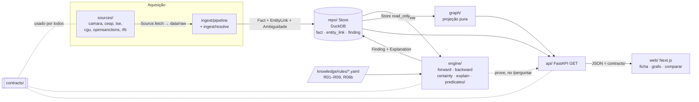

# Arquitetura

## Visão geral
Dependência em uma direção só: cada camada importa apenas as que estão à sua esquerda. `contracts/` é a
única pasta usada por todas e não importa ninguém.

## Papel de cada camada no Sistema Especialista
| Camada | Papel |
|---|---|
| `sources/` + `ingest/` | Aquisição de dados: gera fatos rastreáveis (`fonte`, `id_oficial`, `url`) |
| `ingest/resolve/` | Resolução de entidades: CPF/CNPJ/nome → `entity_link` com CF próprio; ambíguos não ligam |
| `repo/` | **Base de fatos** (memória de trabalho persistida em DuckDB) |
| `knowledge/rules/` | **Base de conhecimento**: regras SE/ENTÃO com CF, penalidades, limitações e fonte metodológica |
| `engine/` | **Motor de inferência**: `forward.py` (progressivo), `backward.py` (regressivo), `certainty.py` (MYCIN), `predicates/` (condições) |
| `engine/explain.py` | **Módulo de explicação**: como, por quê e limitações |
| `graph/` | Projeção dos fatos/findings em nós e arestas (grafo navegável) |
| `api/` | FastAPI somente leitura; recebe `Store(read_only=True)` |
| `web/` | Interface do leigo |

## Fluxo de dados
1. `make ingest` (ou `make sample`): `ingest/pipeline.py` executa as fontes em ordem fixa
   (camara, ceap, cgu, tse, opensanctions, rfb). Cada `Source` baixa o bruto para `data/raw/` e `normalize()`
   devolve `Fact`. O escopo (`--uf`, `--amostra N`) restringe a base aos N primeiros deputados da UF.
2. Resolução: `resolver_candidaturas`, `resolver_emendas`, `resolver_peps`, `resolver_cnpj` produzem
   `deputado_id` nos fatos (só com CF ≥ 0,7), `EntityLink` e `entity_ambiguity`.
3. `make infer` (`engine.run`): carrega fatos no `FactBase` → **guardrails** (prioridade < 10) podam a
   base (R02 remove votos de votações simbólicas; R08 remove `processo` sem trânsito em julgado) → cada regra
   de inferência chama seu predicado → avalia `se` (expressões seguras de `safe_expr.py`) →
   `CF = cf_regra × min(premissas) × penalidades` → `Finding` + `Explanation` gravados.
   Regras compostas (`requer`, ex.: R09) são ignoradas aqui.
4. API: `GET /deputados/{id}/findings` e `/findings/{id}/explicar` só leem. `GET /perguntar` roda
   `backward.prove` sobre os fatos para responder "o deputado X tem objetivo Y?" com CF e trilha da prova.
   `GET /grafo`, `/grafo/backlinks/{id}` e `/comparar` usam `graph/`.
   O cache é invalidado quando a impressão digital do banco muda.
5. Web exibe conclusão, semáforo (`Nivel`) e trilha com links para a fonte oficial.

## Níveis de certeza (`contracts.Nivel`)
alta ≥ 0,7 · média ≥ 0,4 · indício ≥ 0,2 · inconclusivo < 0,2

## Modelo de dados (`repo/migrations`)
`fact` (tipo, chave, atributos, fonte, id_oficial, url), `entity_link` (origem, destino, metodo, cf),
`entity_ambiguity` (002), `finding` e sua `explanation`. Tipos de fato: `docs/fact_types.md`.

## Escala (documentado, não implementado)
DuckDB → Postgres (só `repo/`); cron → Prefect/Dagster (um job por fonte); lote → reavaliação incremental por
tipo de fato; Câmara → Senado/estados = novos plugins. Decisões: `docs/adr/`.
